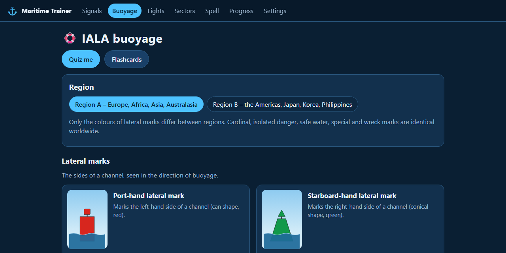

# Maritime Trainer


[](LICENSE)
[](https://github.com/kreaton/MaritimeTrainer/stargazers)

⭐ If Maritime Trainer helps you get ready for the water, [star it on GitHub](https://github.com/kreaton/MaritimeTrainer). It's free, made by one developer, and stars are how other people find it.



**Learn signal flags, Morse code, the phonetic alphabet, IALA buoyage and light characteristics by sight, by ear and by doing.**

▶️ **Try it:** <https://kreaton.github.io/MaritimeTrainer/>

It is a Blazor WebAssembly app (.NET 10) that runs entirely in the browser, with no server or backend. Your progress and settings are saved in the browser.

## What's in it

**Signals**
- ICS signal flags and numeral pennants, the single-flag meanings (e.g. A = diver down), distress signals.
- Morse code you can hear (Farnsworth timing, adjustable speed and tone) and key in yourself.
- The ICAO phonetic alphabet and numerals.
- **Spell**: type a word or message and see it as flags, Morse and spoken phonetics.

**IALA buoyage**
- Lateral marks (Region A and B side by side), preferred-channel marks, safe water (mid-channel), isolated danger, the four cardinal marks, special marks and emergency wreck marks.
- Each mark is drawn with its colours, shape and topmark, and has an animated light.

**Lights**
- Every characteristic (F, Fl, LFl, Q, VQ, UQ, Iso, Oc, Mo, Al, F Fl and the group/composite forms) shown as an animated lamp **and a time band**: black is dark, white (or the light's colour) is lit, and a marker runs along it in step with the lamp.
- **Type your own light** as it is written on the chart, e.g. `Fl(3) G 10s`, `Q(6)+LFl W 15s`, `Oc(2+1) R 12s 15m 8M`, `Mo(U) W 15s` or `Fl WRG 5s`, and see it flash, drawn over time and explained in words.

**Sector lights**
- A drill: you are on a given bearing, what colour do you see? Your position is only revealed after you answer.
- **Your own light**: enter the sectors in a table or paste them light-list style (`R 245°-260°, W -265°, G -280°`), with bearings from seaward or from the light. Explore it with a slider, then quiz yourself on it.

**Practice**
- **Quiz**: pick a deck and a direction (e.g. Morse sound → letter, flag → phonetic, light → mark, abbreviation → light). Choice or typed answers, 10 or 25 questions, a 60-second sprint or survival with 3 lives. Weak items come up more often, and wrong answers are chosen to be easy to confuse.
- **Flashcards** with self-grading, and a **Progress** page with per-item mastery.

### Keyboard shortcuts (quiz)

`1`–`4` choose an answer, `Enter` / `Space` / `→` next, `.` and `-` key Morse, `R` replays the sound.

## Related app

**[Ship Lights](https://github.com/kreaton/ShipLights)** ([try it](https://kreaton.github.io/ShipLights/)) covers the lights carried by vessels rather than by marks: see a set of lights on a black night, say what she is (trawler, sailing vessel, tug and tow, not under command…), which way she is going and what you do under the COLREGs, then see the situation from above.

## Caveats

- This is a training aid. It does not replace the official publications: ICS Pub. 102 (International Code of Signals), IALA R1001 (the Maritime Buoyage System), your chart and the list of lights.
- Charts give a light's rhythm and period but not how long each flash lasts, so the animations and time bands use typical values.
- Flag designs were checked against several sources. Pennants 0, 4 and 8 and the orientation of Oscar are the least certain; check them against ICS Pub. 102.
- Substitute pennants are text only (not drawn).

## Project layout

```
MaritimeTrainer.slnx
src/MaritimeTrainer/
  Models/            Flags, Morse, buoyage marks, lights, the light parser and sector lights (plain C#, no Blazor)
  Components/        Flag, buoy, lamp, time band and sector diagram views
  Pages/             Study pages, quiz, flashcards, sectors, spell, progress, settings
  Services/          Quiz engine, progress and settings (localStorage), audio
  BuildInfo.cs       Version, build time and commit shown in the footer
  wwwroot/
    index.html       Host page, <base href>
    css/app.css      All styling
    js/trainer.js    Morse audio (Web Audio), animated lights and time bands, keyboard
    manifest.webmanifest
    icons/           App icons and favicon, rendered from art/icon.svg
tests/MaritimeTrainer.Tests/
  Program.cs         Checks the model code (light parser, sectors, Morse) without a browser
art/icon.svg         Source of the app icon
tools/
  make-icons.ps1     Renders the PNG icons from art/icon.svg
  make-banner.ps1    Takes the README banner (images/banner.png) from the running app
```

## Running locally

Requires the [.NET 10 SDK](https://dotnet.microsoft.com/download).

```bash
dotnet run --project src/MaritimeTrainer
```

Then open http://localhost:5160.

Stop the app before building it again. A running dev server keeps the list of files it started with, and after a rebuild the page can hang while loading.

## Tests

```bash
dotnet run --project tests/MaritimeTrainer.Tests
```

The test runner checks the light parser (every built-in light, composite and combined rhythms, sector and alternating lights, and inputs that must be refused), sector lights (light-list parsing, the from-seaward conversion, sectors across north, overlaps) and Morse encoding. The exit code is the number of failed checks.

## Publishing

Pushing to `main` runs the tests, builds the app and deploys it to GitHub Pages (<https://kreaton.github.io/MaritimeTrainer/>) with [`.github/workflows/deploy.yml`](.github/workflows/deploy.yml). The version is `1.0.<run number>`, set in [`Directory.Build.props`](Directory.Build.props).

Pages serves the app from `/MaritimeTrainer/`, so the workflow rewrites `<base href="/" />` in `index.html` to match.

## Icons and banner

Both are made with Windows PowerShell and headless Edge:

```bash
powershell -File tools/make-icons.ps1
powershell -File tools/make-banner.ps1   # with the app running on localhost:5160
```

## License & Authorship

This project is distributed under the terms of the [MIT License](LICENSE).

**AI authorship note:** Most of the source code in this repository was generated with AI coding agents (Claude Code), under my direction and review. Purely AI-generated material may not be eligible for copyright protection in some jurisdictions. To the extent any part of this project is protected by copyright, it is licensed under the MIT License, and the license's warranty and liability disclaimers apply to the project as a whole.

<!-- notices:start -->
### Independent development

MaritimeTrainer is an independent, personal project developed by Per Hejndorf. It is not affiliated with, endorsed by or sponsored by IALA, the IMO, Microsoft or any other rights holder. Product names and logos are trademarks of their respective owners and are used only to identify the services and tools the project works with.

### Third-party notices and asset provenance

[THIRD-PARTY-NOTICES.md](THIRD-PARTY-NOTICES.md) lists every third-party library, font and online service the project uses, with version, licence, source and whether it was modified. It also records where the icons, images, audio and video came from and how they are licensed.
<!-- notices:end -->
